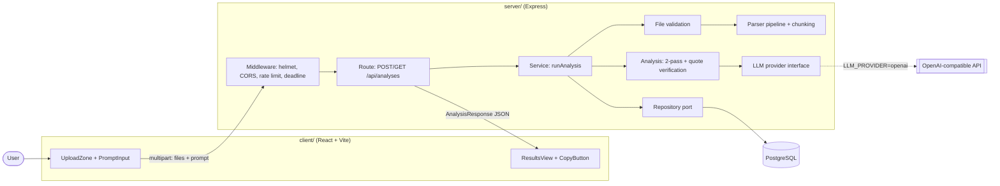
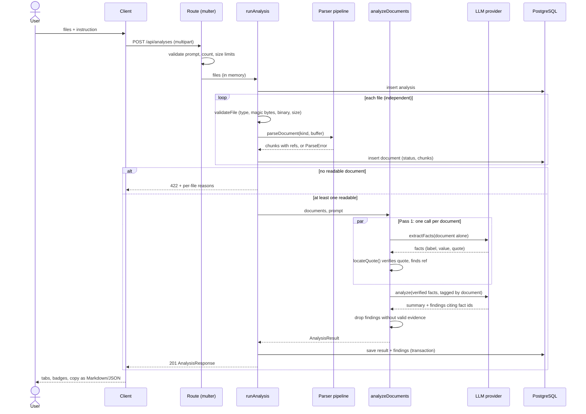
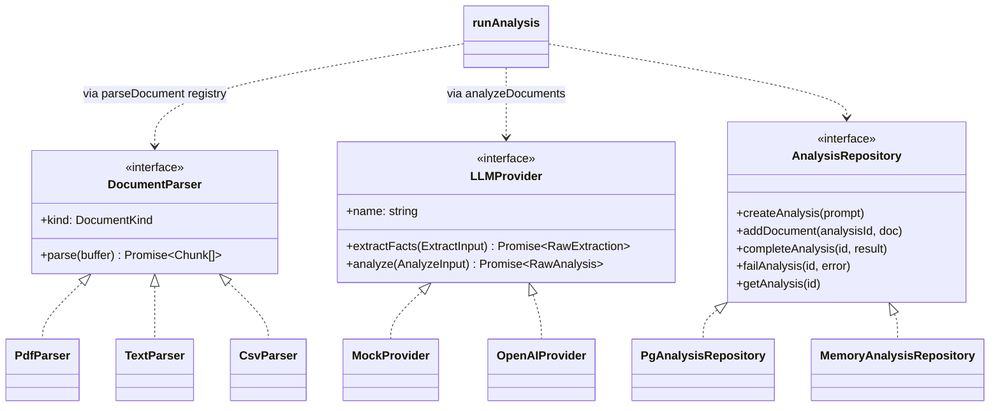
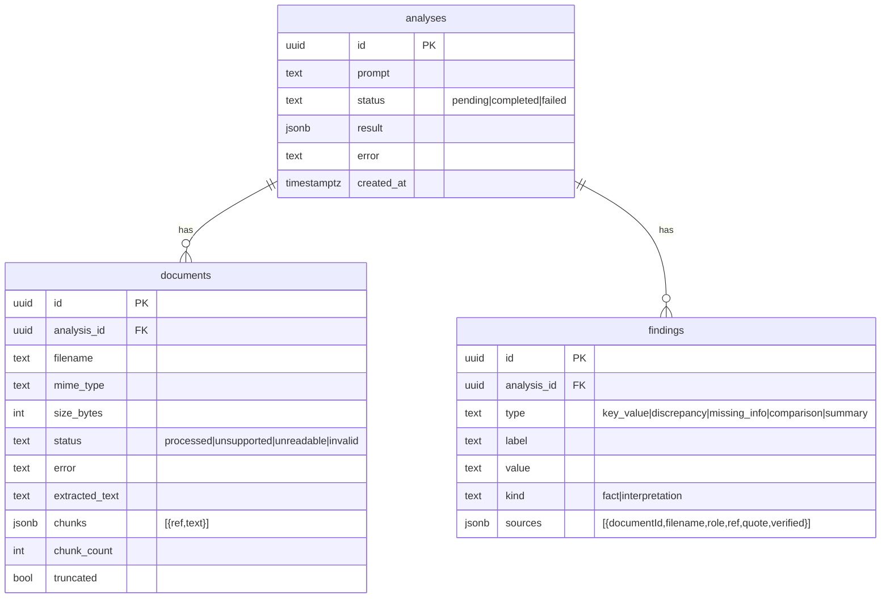

# Architecture

Multi-Document Intelligence Workbench: high-level design (HLD) and low-level design (LLD).

## 1. High-level design

### 1.1 Goals and constraints

- Compare several uploaded documents against a user instruction and return structured findings.
- **Every finding must be traceable** to a document, a location and a quote.
- Keep **extracted facts** distinct from **AI interpretation**.
- Never collapse the documents into one unstructured prompt.
- Frontend and backend are separate TypeScript projects (React / Node.js). Storage is relational (PostgreSQL). The LLM is swappable (mock or OpenAI-compatible).

### 1.2 System context and components



### 1.3 Data flow of one analysis



### 1.4 Key design decisions

| Decision | Reason |
|---|---|
| **Two-pass analysis** (per-document extraction, then collective comparison) | Meets "analyse independently and collectively" and keeps document boundaries. |
| **Server-side quote verification** | The model's evidence is checked against the source text; hallucinated facts are discarded. Provenance becomes a property of the system, not of the model's honesty. |
| **Findings cite fact ids, not free text** | The model cannot invent a source; the server builds `Source` objects from verified facts. |
| **Comparison table built without the LLM** | Every cell is a verified fact, so the table is fully factual. |
| **A `kind` field (`fact` or `interpretation`)** on every finding | Required distinction between extraction and AI reasoning, preserved in DB, API, UI, and copied output. |
| **Provider interface + mock** | Works offline and in tests; real provider is a config change. |
| **Repository port** | Route and service tests run with an in-memory repository, no database needed. |
| **In-memory file handling** | No disk writes, simpler security story, serverless friendly. |
| **Postgres** (not SQLite) | Works on hosted platforms with an ephemeral filesystem; JSONB for provenance. |

### 1.5 Deployment view

- Local: Vite dev server proxies `/api` to Express; Postgres in Docker.
- Hosted target (Vercel): static client build plus the Express app as a serverless function, with a hosted Postgres. Body-size and rate-limit caveats are listed in the README.

## 2. Low-level design

### 2.1 Repository layout

```
client/src/
  App.tsx                 page state: files, prompt, loading, error, result
  api.ts                  submitAnalysis() + ApiError
  format.ts               analysisToMarkdown / analysisToJson (copy output)
  components/             UploadZone, PromptInput, ResultsView, FindingCard, CopyButton
  types.ts                re-exports server domain types (type-only)
server/
  db/schema.sql, seed.sql
  src/
    index.ts, app.ts, config.ts, db.ts
    domain/types.ts       shared domain model (no runtime code)
    validation/           fileValidation.ts
    pipeline/             index.ts (registry), chunking.ts, parsers/{pdf,text,csv}Parser.ts
    llm/                  types.ts (interface + zod schemas), prompts.ts, mockProvider.ts, openaiProvider.ts, index.ts
    analysis/             analyzeDocuments.ts, locateQuote.ts, comparisonTable.ts
    services/             runAnalysis.ts (orchestration)
    repository/           types.ts (port), pgRepository.ts, memoryRepository.ts
    routes/               analyses.ts
    middleware/           errorHandler.ts, limits.ts
    scripts/              initDb.ts, generateSamples.ts
    testUtils/            makePdf.ts
samples/                  synthetic documents
```

### 2.2 Core modules and interfaces



Extension points: add a parser by registering it in `pipeline/index.ts`; add an LLM provider by implementing `LLMProvider` and selecting it in `llm/index.ts`.

### 2.3 Validation and parsing rules

| Stage | Rule | Result on failure |
|---|---|---|
| Upload (multer) | ≤ `MAX_FILES`, ≤ `MAX_FILE_MB` each | 400 / 413 |
| Prompt (zod) | 1 to 2000 chars | 400 |
| `validateFile` | extension in `.pdf/.txt/.csv`; declared MIME matches or is `octet-stream`; non-empty; PDF starts `%PDF-`; text/CSV has no NUL bytes | document status `unsupported` or `invalid` |
| Parser | PDF has extractable text; text is valid UTF-8; CSV has data rows | status `unreadable` |
| Chunking | about 3000 chars per chunk; refs `page N`, `lines a-b`, `row N`; per-document cap 48,000 chars | `truncated = true` |

Refs: PDFs are split by page, text by line number, CSV by spreadsheet row (header is row 1). CSV rows are rendered `[row N] Column: value | Column: value`, so a quote can be narrowed to the exact row.

### 2.4 Analysis algorithm (`analyzeDocuments`)

1. Assign short labels `D1..Dn` to documents.
2. **Pass 1**, for each document in parallel: batch its chunks (≤ 12,000 chars per call) and call `extractFacts`. For each returned fact, `locateQuote` searches for the quote (case and whitespace-insensitive) in that document's chunks:
   - not found → fact dropped, counted in a warning;
   - found → fact kept with its `ref` (row-level for CSV); duplicates removed; at most 150 facts per document.
3. A document whose extraction fails is skipped with a warning; if all fail, the request fails with the LLM error.
4. Give each fact an id `F1..Fn`. Each becomes a `key_value` finding with `kind: "fact"`.
5. **Pass 2**: call `analyze` with documents and (up to 300) facts. For each returned finding: map `factIds` to verified `Source`s and `absentFromDocuments` to `role: "absent"` sources. Keep it only if a discrepancy cites at least two valid facts, or a missing-info finding has at least one valid source. Kept findings get `kind: "interpretation"`.
6. Build the comparison table from verified facts only.

### 2.5 Data model



`analyses.result` holds the full result document (served by `GET`); `findings` stores the same findings in relational form for querying. Both are written in one transaction on completion. See [`server/db/schema.sql`](server/db/schema.sql).

### 2.6 API contract

`POST /api/analyses`, `multipart/form-data`: `prompt` (text), `files` (1..N).

| Status | Meaning | Body |
|---|---|---|
| 201 | Analysis completed (some files may have been skipped) | `AnalysisResponse` |
| 400 | Missing/invalid prompt, no files, too many files, malformed body | `{ error }` |
| 413 | A file or body is too large | `{ error }` |
| 422 | No document could be read | `{ error, analysisId, documents[] }` |
| 429 | Rate limit exceeded | `{ error }` |
| 502 | LLM failure (timeout, HTTP error, invalid output twice) | `{ error, analysisId, documents[] }` |
| 503 | Request exceeded the overall deadline | `{ error }` |

`GET /api/analyses/:id`: 200 `AnalysisResponse`, 400 invalid id, 404 unknown id. `GET /api/health`: `{ status, provider }`.

```ts
interface AnalysisResponse {
  id: string; prompt: string; status: "completed" | "failed"; createdAt: string;
  documents: { id; filename; sizeBytes; status; kind?; reason?; chunkCount; truncated }[];
  result?: {
    provider: string;
    summary: string;                       // AI interpretation
    findings: Finding[];
    comparisonTable: { columns; rows };    // verified facts only
    warnings: string[];
  };
  error?: string;
}
interface Finding {
  type: "key_value" | "discrepancy" | "missing_info" | "summary";
  label: string; value: string;
  kind: "fact" | "interpretation";
  sources: { documentId; filename; role: "supports" | "absent";
             ref?; quote?; verified: boolean }[];
}
```

### 2.7 LLM contract

Pass 1 output (validated with zod, retried once on failure):
`{ "facts": [{ "label", "value", "quote" }] }`, where `quote` must be verbatim from the document.

Pass 2 output:
`{ "summary", "findings": [{ "type": "discrepancy" | "missing_info", "label", "description", "factIds": [], "absentFromDocuments": [] }] }`.

Prompts (`llm/prompts.ts`) wrap document text in delimiters, state that it is untrusted data, and forbid inference. JSON mode and `temperature: 0` are used with the OpenAI-compatible provider. All provider failures surface as `LLMError` with safe messages.

### 2.8 Error handling

- Per-file problems become document statuses, not request failures.
- `errorHandler` maps multer and body-parser errors to 4xx; anything else is a generic 500 and is logged server-side only.
- Unknown routes return JSON 404.
- LLM errors → 502 with a safe message; the analysis row is marked `failed`.

### 2.9 Testing strategy

| Area | Tests |
|---|---|
| Validation | accept/reject by type, MIME, magic bytes, binary, empty; filename sanitising |
| Pipeline | chunk boundaries and refs, truncation, text, CSV rows, real generated PDFs, corrupt and empty PDFs |
| Analysis | quote verification, hallucinated facts and findings are dropped, one document failing, all failing, comparison table, mock discrepancy and missing-info logic |
| LLM provider | retry on invalid JSON, failure after two invalid replies, HTTP error mapping (stubbed `fetch`) |
| API | end-to-end with supertest and in-memory repo: mixed good/bad files, 422, 502, validation, GET |
| Middleware | 404, malformed JSON, headers, rate limiting |
| Client | Markdown copy output (fact/interpretation sections, sources, quotes, table) |
